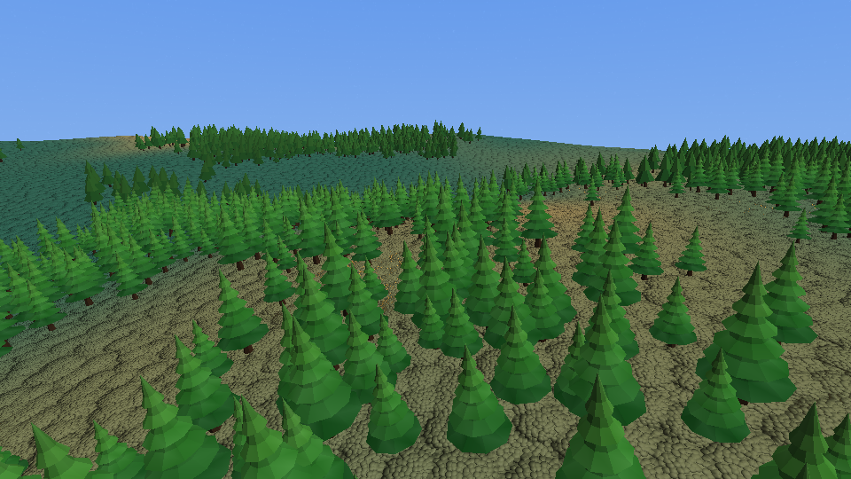
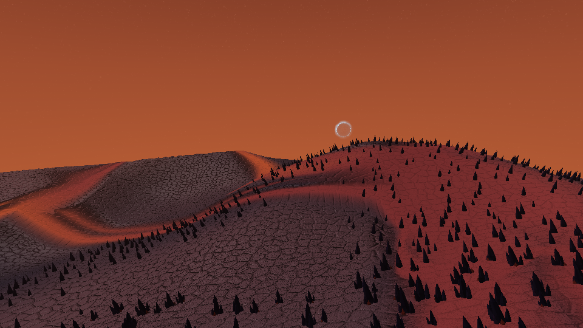
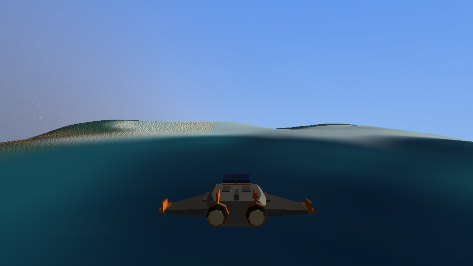
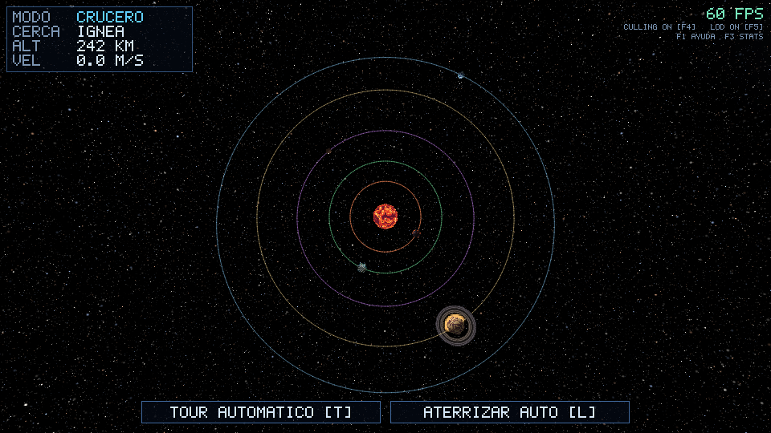
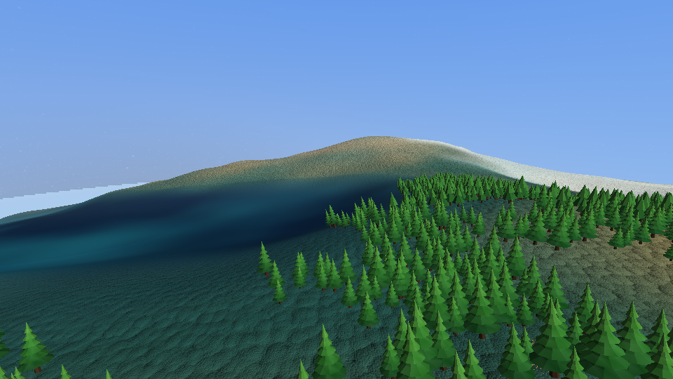
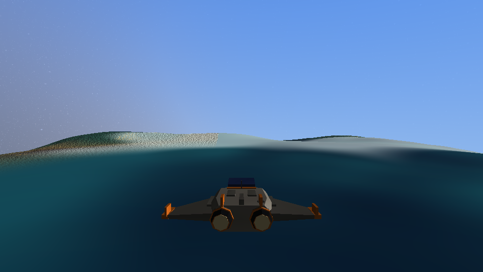
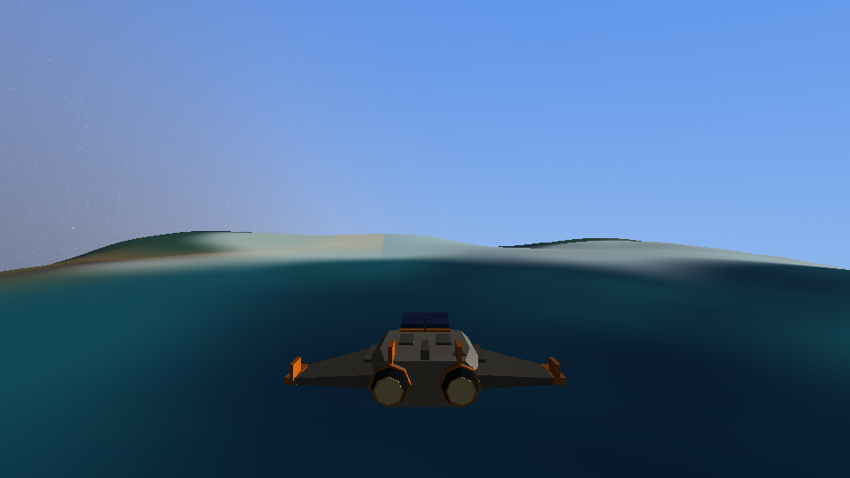

# Galaxy: sistema solar explorable con renderizador por software

Proyecto final de Gráficas por Computadora 2026 (entrega 20/11/2026). Es un juego de piratas espaciales en un sistema solar pequeño: se buscan tesoros en los planetas, se combate contra patrullas de policía y se evita un agujero negro en el borde. La nave conserva inercia, gravedad y colisión, y el Tour automático viaja de planeta en planeta, orbita, desciende y aterriza. Todo el dibujo se calcula en la CPU con un pipeline propio (matrices, recorte, z-buffer, rasterizado por tiles y sombreado diferido). Raylib solo abre la ventana, lee el teclado y el ratón y muestra el framebuffer como una textura 2D.


## Compilar y ejecutar

Necesitas Rust (edición 2024, cargo reciente), CMake y un compilador de C, porque `raylib` construye su biblioteca nativa la primera vez. Las únicas dependencias son `raylib` y `rayon` (ver `Cargo.toml`); Cargo las descarga solo.

```bash
cargo test                       # pruebas unitarias y de integración
cargo run --release              # portada y juego interactivo 960x540
cargo run --release -- --tour    # igual, pero con el Tour automático ya iniciado
```

Siempre ejecuta desde la raíz del repositorio: el programa carga `assets/models/ship.obj` con una ruta relativa. Usa `--release`; en modo debug el sombreado por CPU es demasiado lento.

Opciones de línea de comandos (las que imprime `--help`):

| Opción | Qué hace |
|---|---|
| `--tour` | Omite la portada y abre la ventana con el piloto automático iniciado |
| `--bench [--frames N]` | Recorre el Tour sin ventana con y sin culling/LOD y compara tiempos y triángulos (N=3000 por defecto) |
| `--record DIR [--frames N] [--every K]` | Guarda en `DIR` un PNG cada K cuadros del Tour (N=1800 y K=60 por defecto), sin ventana |
| `--shot out.png [--time T] [--stats]` | Vista del sistema en un PNG (`--stats` imprime los contadores) |
| `--menu-shot out.png` | Captura la portada en PNG sin abrir la ventana |
| `--shot-ship out.png [--gear G]` | Vista de la nave en un PNG; G va de 0 (tren plegado) a 1 (desplegado) |
| `--surface-shot out.png --body verdalia --alt 40 [--seed N]` | Vista de los objetos sobre el suelo |
| `--atmos-shot out.png --body verdalia --alt 40 [--sun GRADOS] [--az GRADOS] [--space] [--no-normalmap]` | Vista de atmósfera y comparación del mapa de normales |
| `--terrain-shot out.png [--alt M] [--kind verdalia]` | Demostración del terreno con LOD |
| `--orbits-shot out.png` | Líneas de órbita desde arriba |
| `--death-shot DIR` / `--landing-shot DIR` | Secuencias de muerte y aterrizaje asistido |
| `--seed N` | Distribución reproducible de objetos, 1 por defecto |
| `--scale S` | Escala interna fija: 1, 0.85, 0.7 o 0.55; se aplica en ventana y `--bench` |

Para generar el video de la demostración se necesita `ffmpeg`:

```bash
scripts/record-demo.sh           # graba 90 s del Tour y arma videos/galaxy-demo.mp4
scripts/video.sh frames video.mp4   # solo convierte un directorio de cuadros (60 fps, 960x540, H.264 yuv420p)
```

`record-demo.sh` acepta `CUADROS` y `CADA_K` como argumentos (`scripts/record-demo.sh 3600 1`). Cada PNG pesa unos 2 MB, así que 90 s con `CADA_K=2` ocupan unos 5 GB en `frames/` (carpeta ignorada por git). Si la secuencia se grabó con `--every K`, `video.sh` necesita `FPS_ENTRADA=$((60/K))`; `record-demo.sh` ya lo hace.
El modo `--record` renderiza todos los cuadros para mantener las cachés del terreno y los objetos al día, pero solo guarda un PNG cada K cuadros.

## Controles

Tomados de `src/platform.rs` y de la pantalla de ayuda (`F1`, `HELP_ROWS` en `src/hud.rs`).

| Tecla | Acción |
|---|---|
| `Enter` / `Espacio` | Iniciar la partida desde la portada |
| `W` / `S` | Adelante / atrás |
| `A` / `D` | Lateral izquierda / derecha |
| `Q` / `E` | Abajo / arriba en la nave |
| `E` | Recoger un tesoro cuando se está a pie y cerca de él |
| `B` | Solicitar descenso y bajar de la nave; cerca de ella, volver a abordar |
| `Espacio` | Disparar desde la nave o a pie |
| Flechas | Cabeceo y guiñada |
| `Z` / `C` | Alabeo |
| Botón derecho | Arrastrar para mirar libremente sin girar la nave |
| `M` / botón central | Alternar timoneo con el ratón |
| `Shift` / `Ctrl` | Turbo / freno en la nave; `Shift` permite correr a pie |
| `G` | Gravedad encendida / apagada |
| `X` | Asistencia de vuelo encendida / apagada |
| `T` o clic en el botón del HUD | Iniciar / detener el Tour automático |
| `L` o botón `ATERRIZAR AUTO` | Aterrizaje automático (solo si la nave está en ORBITA o DESCENSO sobre un planeta aterrizable) |
| `F1` | Ayuda con la tabla de controles |
| `F3` | Panel de estadísticas del pipeline |
| `F4` | Frustum culling de las llamadas del rasterizador encendido / apagado |
| `F5` | LOD encendido / apagado |
| `F6` | Alternar resolución automática y 100 %, salvo si se fijó `--scale` |
| `N` | Mapa de normales encendido / apagado |
| `O` | Líneas de órbita encendidas / apagadas |
| `K` / `Supr` | Reaparecer |
| `1`-`6` | Viajar al cuerpo elegido; `1` es el sol |
| `P` | Captura PNG en `screenshots/vista-N.png` |
| `Esc` | Salir |

Cualquier mando del jugador interrumpe el Tour y devuelve el control sin saltos. En tierra, `WASD` mueve al pirata, las flechas giran la vista y el botón derecho permite mirar con el ratón.

En crucero no hay un tope de velocidad de juego: el turbo aumenta la aceleración mientras se mantiene pulsado. La simulación solo conserva una cota técnica alta para evitar valores extremos. Cerca del suelo, el turbo permite superar 2 m/s con mayor facilidad sin perder el control local; al soltarlo vuelve el límite de velocidad de descenso.

En órbita o descenso sobre un planeta aterrizable, `B` activa el aterrizaje asistido y baja automáticamente al pirata cuando la nave se posa. Cada planeta aterrizable tiene un tesoro; el HUD indica su distancia. Las patrullas aparecen cerca de los planetas y persiguen al jugador, también a pie. Cada patrulla resiste dos impactos. Si la nave se aleja demasiado del sistema, aparece un agujero negro que la atrae; cruzar el límite destruye la nave y `K` permite reaparecer.

Las teclas `1`-`6` inician un viaje automático al cuerpo elegido (`1` es el sol; llega, orbita una vuelta y devuelve el control). El botón derecho del ratón con arrastre es mirada libre de la cámara (vuelve suave al soltar). `M` o el botón central alterna que el ratón timonee la nave. La nave también se orienta con flechas y `Z`/`C`.

## Arquitectura del pipeline

```
mundo (f64)  ->  vértices  ->  ensamblado y recorte  ->  tiles  ->  sombreado diferido  ->  framebuffer  ->  raylib (textura)
src/world        raster/pipeline.rs (todo el rasterizador)                                     src/platform.rs
```

| Etapa | Qué hace | Dónde |
|---|---|---|
| Mundo y tiempo | Posición orbital y rotación como función analítica del tiempo de simulación; origen flotante (resta en `f64`, luego pasa a `f32`) | `src/world/mod.rs` (`Body::position`, `body_model_matrix`) |
| Geometría | Icosfera subdividida (20·4ⁿ triángulos), niveles de detalle, lector OBJ | `src/geometry/sphere.rs`, `lod.rs`, `obj.rs` |
| Culling por llamada | Prueba esfera contra los 6 planos del frustum antes de procesar vértices | `raster/pipeline.rs` (`frustum_planes`, `sphere_visible`) |
| Vértices | Transforma con `vista * modelo` y luego la proyección | `raster/pipeline.rs`, matrices en `src/math.rs` (`Mat4::perspective`, `look_at`, `translation`, `rotation_y`, `scale`) |
| Ensamblado y recorte | Descarte de caras traseras, recorte contra el plano cercano (`clip_near`), conversión a punto fijo 28.4 | `raster/pipeline.rs` (`setup`, `clip_near`) |
| Tiles | La pantalla se divide en tiles de 64x64 que se rasterizan en paralelo con `rayon`; cada tile guarda un buffer de visibilidad con z-buffer `1/w` | `raster/pipeline.rs` (`TILE`, `raster_tile`) |
| Sombreado diferido | Solo se ejecuta el shader en los píxeles que ganaron la prueba de profundidad | `raster/pipeline.rs`, trait `FragmentShader` en `src/raster/mod.rs` |
| Shaders | Un shader propio por cuerpo, más anillo, nave y cielo | `src/shading/` |
| Cielo | Cubemap de estrellas precalculado al arrancar | `src/app.rs` (`SkyBox`) |
| Simulación | Paso fijo de 1/120 s con acumulador, física, gravedad, colisión, modos de vuelo, autopiloto | `src/ship/` |
| HUD | Fuente bitmap y botones dibujados en el framebuffer | `src/hud.rs` |
| Ventana | Único módulo que usa raylib | `src/platform.rs` |

El panel `F3` muestra también las hojas y triángulos del terreno, los objetos dibujados o descartados y la escala interna. El HUD se dibuja a 960x540 incluso si el mundo se renderiza a una escala menor.

## Cumplimiento de los requisitos eliminatorios

| Requisito | Dónde se ve o se verifica |
|---|---|
| Pipeline de software propio; raylib solo ventana, entrada y mostrar el framebuffer | Solo `src/platform.rs` usa raylib (ventana, teclado, ratón, `update_texture` y `draw_texture_pro`). `src/hud.rs` escribe en el framebuffer a mano. No se usa `draw_model`, `Camera3D`, shaders GLSL ni física de raylib |
| Sol, nave modelada por nosotros y al menos un planeta | Sol Ígnea y cinco planetas en `world::solar_system`. La nave `assets/models/ship.obj` se genera con `assets/src/make_ship.py`; ver `screenshots/nave.png` (`cargo run --release -- --shot-ship nave.png`) |
| Nave controlable | `src/ship/physics.rs` (`step`); probar con `W/A/S/D/Q/E`, flechas, `Shift` y `Ctrl` |
| Planetas que orbitan y rotan según el tiempo transcurrido, no los cuadros | `Body::position(t)` y `Body::rotation_angle(t)` en `src/world/mod.rs` son funciones puras del tiempo; la prueba `orbit_is_periodic_and_stateless` lo verifica. El tiempo `sim.t` avanza en múltiplos exactos de 1/120 s (`src/ship/stepper.rs`); la prueba `fixed_step_is_frame_rate_independent` simula con distintos FPS y obtiene la misma posición |
| Acercarse y alejarse sin pantalla de carga | Un solo mundo y un solo bucle (`app::run`); el LOD cambia de malla en caliente con histéresis. Se ve en el Tour o volando hacia Verdalia |
| Poder orientar la nave y ver el entorno al acercarse | La nave se orienta con flechas y `Z`/`C`; con el botón derecho del ratón se mira libremente sin cambiar el rumbo (`src/ship/camera.rs`, `CameraRig::update`) |
| Matrices de modelo, vista y proyección y prueba de profundidad | `body_model_matrix` (modelo), `CameraRig::view_matrix` (vista), `Mat4::perspective` (proyección) y el z-buffer `1/w` de `raster/pipeline.rs`; pruebas en `src/raster/tests.rs` |
| Al menos un shader de fragmentos propio | Seis shaders en `src/shading/` (sol, Verdalia, Siroco, Mutante, Nix, Fornax) más anillo, nave y cielo |
| Entrega: código, recursos, instrucciones y video del recorrido | Este README, `assets/`, `scripts/record-demo.sh` y `scripts/video.sh`. `[VIDEO: enlace al mp4 final]` |

El video debe mostrar vuelo espacial, acercamiento, vuelta alrededor de un planeta y alejamiento: el Tour hace exactamente esa secuencia (ver `docs/10-guion-demo.md`).

## Características del menú que se solicitan evaluar y dónde verlas

Los contadores de `F3` incluyen llamadas y triángulos del rasterizador, hojas y triángulos del terreno, instancias y triángulos de objetos, tiempos de vértices, raster, sombreado y atmósfera, y escala interna.

| Característica | Estado | Dónde está | Cómo demostrarlo en vivo |
|---|---|---|---|
| Planetas (5) | Hecho | `world::solar_system` en `src/world/mod.rs`: Fornax, Verdalia, Mutante, Siroco y Nix, más el sol Ígnea | `--shot screenshots/sistema.png` los muestra en fila; en la ventana, volar hacia cada uno o dejar el Tour |
| Shaders propios (4 distintos) | Hecho | `src/shading/`: `rocky.rs` (Verdalia), `giant.rs` (Siroco), `ice.rs` (Nix), `volcanic.rs` (Fornax), más `sun.rs`, `pixel.rs`, `props.rs` y `sky.rs`. `shader_for` en `src/shading/mod.rs` | Acercarse a cada planeta y comparar su aspecto |
| Shader animado | Hecho | Lava de Fornax y nubes de Verdalia (usan `Uniforms::time`), tormenta de Siroco, granulación del sol, vaca a cerdo de Mutante (24 s de ciclo, `pixel.rs`) | Mirar Siroco o el sol unos segundos: las bandas y la granulación cambian solas |
| Deformación por ruido | Hecho | `relief::height` (`src/relief.rs`) desplaza cada planeta (Verdalia ±3 %, Fornax ±3.5 %, Nix ±2 %, Mutante ±2.5 % en 16 escalones) mediante `geometry::displace`; `relief::displaced_lods` genera la malla de cada nivel de LOD | Mirar la silueta de Verdalia o Fornax de cerca: ya no es una esfera lisa |
| Subdivisión procedural de geometría | Hecho | `icosphere(n)` en `src/geometry/sphere.rs` genera 20·4ⁿ triángulos; `SphereLods` crea los niveles 0 a 5 al arrancar | Con `F5` apagado todos los planetas usan el nivel 5; con `F5` encendido se ve `TRI ENTRADA` bajar |
| Descarte fuera de vista (culling) | Hecho | Frustum culling por esfera y descarte de caras traseras en `raster/pipeline.rs`; contadores en `Stats` (`src/raster/mod.rs`) | `F3`; mirar a otro lado y ver subir `CULL` en `DRAW CALLS`; `F4` apaga el frustum culling y `TRI ENTRADA` sube |
| Niveles de detalle (LOD) | Hecho | Esferas por error de silueta, terreno por quadtree y objetos con malla completa o simplificada. `F5` cambia los tres y el detalle de los shaders | `F3` y `F5`: comparar triángulos de entrada, hojas de terreno y triángulos de objetos |
| Objetos propios y distribución con semilla | Hecho | `src/scatter/` coloca árboles, espiras, cristales y edificios en el marco local del planeta; `--seed N` cambia la distribución | `--surface-shot` con semillas distintas; `F3` muestra instancias y triángulos |
| Orientación sobre superficie curva | Hecho | `src/scatter/place.rs` orienta cada objeto según la normal del relieve; `Scene::render` aplica a los objetos la misma matriz que al terreno | Ver un bosque al girar el planeta; los objetos siguen pegados a él |
| Mapa de normales | Hecho | `src/shading/normalmap.rs`, controlado con `N` | Alternar `N` cerca del suelo o comparar `--atmos-shot` con `--no-normalmap` |
| Aceleración progresiva con paso fijo | Hecho | `src/ship/stepper.rs` (`FixedStepper`, 1/120 s con acumulador) y `src/ship/physics.rs`: la entrada fija una aceleración objetivo que la nave alcanza con constante de tiempo `TAU_ACCEL` (`src/ship/modes.rs`) | Mantener `W` y ver el `VEL` del HUD subir gradualmente; soltar y ver que se frena con suavidad. La prueba `fixed_step_is_frame_rate_independent` lo asegura |
| Gravedad | Hecho | `Body::gravity_at` en `src/world/mod.rs` y `effective_gravity` en `src/ship/physics.rs` | Apagar la asistencia con `X`, acercarse a un planeta con `G` activo y soltar los motores: la trayectoria se curva. Con `G` apagada sigue recta |
| Colisión | Hecho (contra el relieve) | `sweep_collisions` y `collide` en `src/ship/physics.rs`: barrido del movimiento y nave como esfera de 6 m contra `surface_height_at` | Un contacto suave permite posarse; un impacto por encima de 120 m/s destruye la nave y permite reaparecer |
| Control local alrededor de un planeta | Hecho | Modos ORBITA y DESCENSO en `update_mode` (`src/ship/physics.rs`) y constantes en `src/ship/modes.rs`; la nave hereda el movimiento del planeta | El HUD (`MODO`) cambia a ORBITA al bajar de 3 radios; el planeta deja de "escaparse" y se puede rodear a baja velocidad |
| Presentación | Hecho | HUD con modo, planeta cercano, altitud y velocidad, botones del Tour, ayuda (`F1`) y estadísticas (`F3`) en `src/hud.rs` | `F1` y `F3` |

También funcionan, aunque no están en la lista de puntos: Tour automático y aterrizaje automático (`src/ship/autopilot.rs`), anillo de Siroco como malla propia (`geometry::ring_mesh`) y cielo con cubemap.

El terreno con chunks y LOD continuo se usa al bajar de 0.5 radios de altitud (`src/terrain/`). La atmósfera, el tren de aterrizaje animado, el aterrizaje asistido, el sol letal y la muerte por impacto también están integrados. Quedan como ampliaciones la luna de Verdalia y los planetas Dunara, Nublar y Egrin (`docs/07-assets-y-temas.md`).

## Parámetros para cambiar en la demostración

Se cambian en el código y se recompila con `cargo run --release` (no hay archivo de configuración).

| Qué | Dónde | Cómo |
|---|---|---|
| Radio de un planeta | `world::solar_system` en `src/world/mod.rs`. Cada fila es `b(tipo, nombre, radio, orbit_radius, orbit_period, rotation_period, inclinación, fase, gm, aterrizable)`; el radio es el tercer valor (por ejemplo `3500.0` en Verdalia) | La gravedad superficial se recalcula sola porque `gm = g(radio)` con `g = 30·r²` |
| Velocidad orbital | Misma fila: `orbit_period` (segundos por vuelta; menor valor, órbita más rápida, por ejemplo `800.0` en Verdalia) y `orbit_radius` (metros al sol) | La órbita es función del tiempo, así que el cambio se nota de inmediato |
| Velocidad de rotación | `rotation_period`, el valor siguiente (segundos por vuelta) | Se ve en el patrón del planeta, que gira con el cuerpo |
| Fuerza de la gravedad | `let g = |r: f64| 30.0 * r * r;` en `solar_system`; alcance en `Body::influence_radius` (8 radios) y suavizado en `gravity_epsilon` | Apagar con `G` para comparar |
| Umbral de LOD de la geometría | `MAX_ERROR_PX` (2 px) en `src/geometry/lod.rs`; histéresis `LOD_MARGIN` y niveles máximos (`SphereLods::new(5, ...)`) en `src/app.rs` | Subir `MAX_ERROR_PX` usa mallas más gruesas; verlo con `F3` |
| LOD de los shaders | `detail = (coverage * 8.0).clamp(0.15, 1.0)` en `Scene::render` (`src/app.rs`) y `octaves` en `src/shading/noise.rs` | `F5` lo fuerza a 1.0 |
| Intensidad del bump y parallax de Fornax | Banderas `bump` y `parallax` de `VolcanicShader` (`shader_for` en `src/shading/mod.rs`); fuerza en `src/shading/volcanic.rs`: factores `0.014` (placas), `0.10` (basalto) y `0.03` (parallax) | Poner `bump: false` o `parallax: false` y comparar con Fornax de cerca |
| Cantidad de continentes y nubes en Verdalia | Umbrales `smooth(0.44, 0.54, ...)` (tierra) y `smooth(0.54, 0.63, ...)` (nubes) en `src/shading/rocky.rs` | Cambia de inmediato la apariencia de Verdalia |
| Velocidad de la tormenta y el sol | `t * 0.45` en `src/shading/giant.rs`; `t * 0.32` en `src/shading/sun.rs` | |
| Respuesta de la nave | `ACCEL_FWD`, `TAU_ACCEL`, `RATE_*`, `BOOST_ACCEL_MAX`, `BOOST_RAMP_TAU` y `SPEED_LIMIT` en `src/ship/modes.rs` | |
| Resolución | `WIDTH` y `HEIGHT` en `src/app.rs` | |
| Frecuencia de simulación | `FixedStepper::default_120` en `src/ship/stepper.rs` | |

## Medición de rendimiento

`--bench --frames 600` mide el comienzo del Tour sin ventana. Se usó la compilación `--release` y se fijaron hilos y escala. Cada fila de abajo tiene culling y LOD encendidos. El programa también imprime la comparación con ambos apagados.

| Hilos Rayon | Escala | ms medio | ms máximo | Triángulos de entrada por cuadro | Atmósfera, ms/cuadro |
|---:|---:|---:|---:|---:|---:|
| 16 | 1.0 | 15.25 | 44.98 | 22 404 | 1.99 |
| 16 | 0.7 | 6.33 | 20.96 | 17 797 | 0.78 |
| 4 | 1.0 | 23.45 | 46.77 | 22 404 | 3.77 |
| 4 | 0.7 | 12.28 | 34.56 | 17 797 | 1.88 |
| 2 | 1.0 | 42.80 | 58.76 | 22 404 | 7.08 |
| 2 | 0.7 | 23.13 | 43.85 | 17 797 | 3.64 |

La escala automática baja un paso cuando el promedio móvil supera 22 ms durante alrededor de 0.5 s; sube cuando se mantiene bajo 13 ms durante 2 s. Si el paso superior acababa de ser demasiado lento, solo vuelve a intentarlo cuando la media cae bajo 10.5 ms, para evitar saltos continuos entre dos escalas. Por eso se espera que baje en máquinas de dos o cuatro hilos, aunque el controlador todavía requiere una prueba visual en la ventana real. El HUD permanece a 960x540. `--bench` mide el renderizado interno; no incluye el reescalado ni el HUD.

Como referencia adicional, con dos hilos y escala 0.55 la media de 600 cuadros fue 19.38 ms; con cuatro hilos y escala 0.85 fue 22.76 ms.

Estas cifras varían con la carga de la máquina. Los primeros 600 cuadros aún no incluyen el descenso, por lo que el máximo de esta tabla no describe todo el Tour. La medición de 6300 cuadros y el pico cerca del suelo están en `docs/09-estado.md`.

En 6300 cuadros con 16 hilos, culling y LOD, la escala 1.0 dio 12.47 ms medios y 45.94 ms máximos; la escala 0.7 dio 8.01 ms medios y 44.21 ms máximos. El pico a 0.7 fue el primer cuadro, con 38.03 ms de sombreado. La meta de 25 ms máximos aún no se cumple. Al apagar culling y LOD, la media subió a 14.15 ms en escala 1.0 y a 9.25 ms en 0.7.

`F4` desactiva el culling por frustum de las llamadas del rasterizador; la selección del quadtree todavía limita los chunks del terreno. `F5` fuerza las esferas a su malla más fina, reduce el umbral del terreno de 10 a 8 píxeles y usa los modelos completos de objetos dentro del rango de dibujo.

## Capturas

| | |
|---|---|
|  |  |
| `--shot screenshots/sistema.png --time 5` | `--shot-ship screenshots/nave.png --gear 1` |
|  |  |
| `--surface-shot --body verdalia` | `--surface-shot --body fornax` |
|  |  |
| `--atmos-shot --space` | `--orbits-shot` |
|  |  |
| `--surface-shot --seed 7` | `--atmos-shot` |
|  | |
| `--atmos-shot --no-normalmap` | |

## Recursos externos y asistencia de IA

- **Asistencia de IA.** Este proyecto se desarrolló con Claude Code (Anthropic), usando varios agentes que generaron código y documentación bajo mi dirección: yo definí el alcance, la arquitectura y las decisiones, y los agentes escribieron buena parte de las implementaciones, pruebas y scripts. Revisé el resultado y puedo explicarlo, pero declaro que una gran parte del código fue generada con IA.
- **Dependencias.** Solo `raylib` 5.5 (ventana, entrada y textura 2D) y `rayon` 1 (paralelismo por tiles).
- **Shaders.** Adaptados del laboratorio de la materia `lab6` (Atlas de mundos): Ígnea, Verdalia, Siroco, Mutante, Nix y Fornax, portados a este pipeline.
- **Pipeline.** El lector de OBJ y la idea del rasterizado baricéntrico con z-buffer vienen del laboratorio `cargar-modelo`; aquí se reescribieron con tiles, punto fijo y sombreado diferido.
- **Modelos.** La nave y cuatro objetos de superficie (árbol, obsidiana, cristal de hielo y edificio) salen de scripts en `assets/src/` (`make_ship.py`, `make_props.py`, `meshlib.py`), sin modelos descargados. Detalles en `assets/models/ship.md`.
- No se usan texturas ni imágenes externas en la escena; el color sale de shaders procedurales y de los colores de vértice de los modelos.

## Integrantes y contribuciones

El proyecto es individual.

| Integrante | Correo | Contribución |
|---|---|---|
| [NOMBRE] | marcoalejandro.diazcastaneda@gmail.com | Todo el proyecto: diseño, integración, revisión del código generado con IA, shaders, simulación, HUD, assets y entrega |

[PENDIENTE: ajustar la descripción de contribuciones antes de entregar]

## Documentación del proyecto

El plan completo está en `docs/` (empezar por `docs/00-indice.md`); el estado actual en `docs/09-estado.md` y el guion de la demostración en `docs/10-guion-demo.md`.
