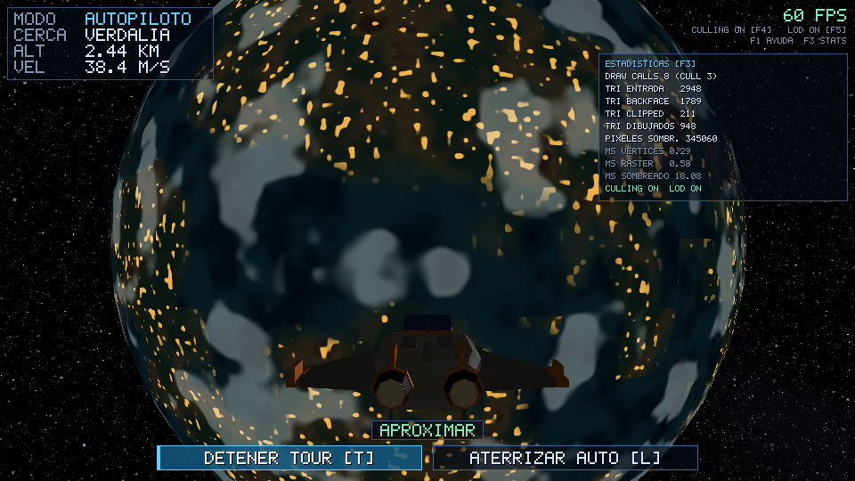
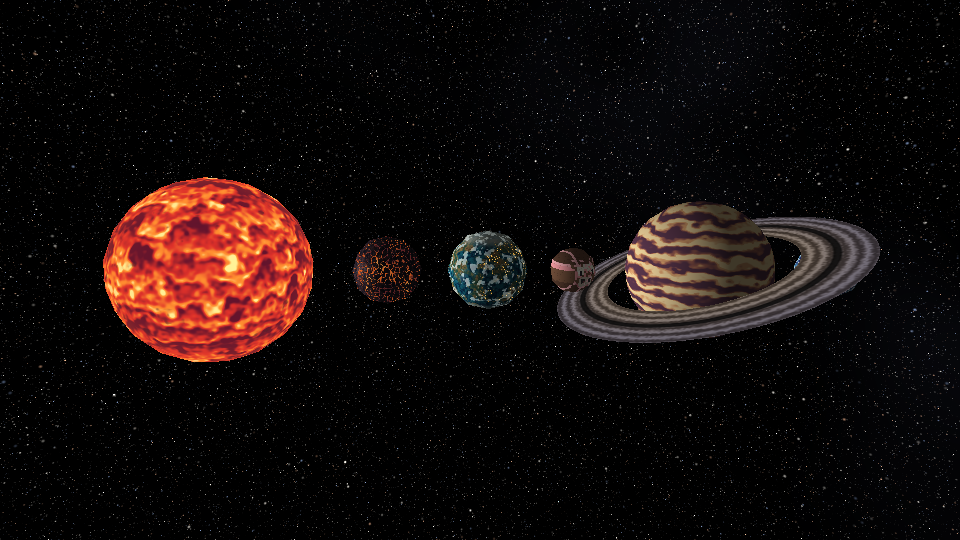
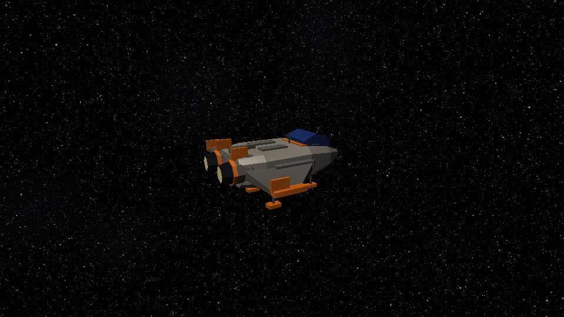
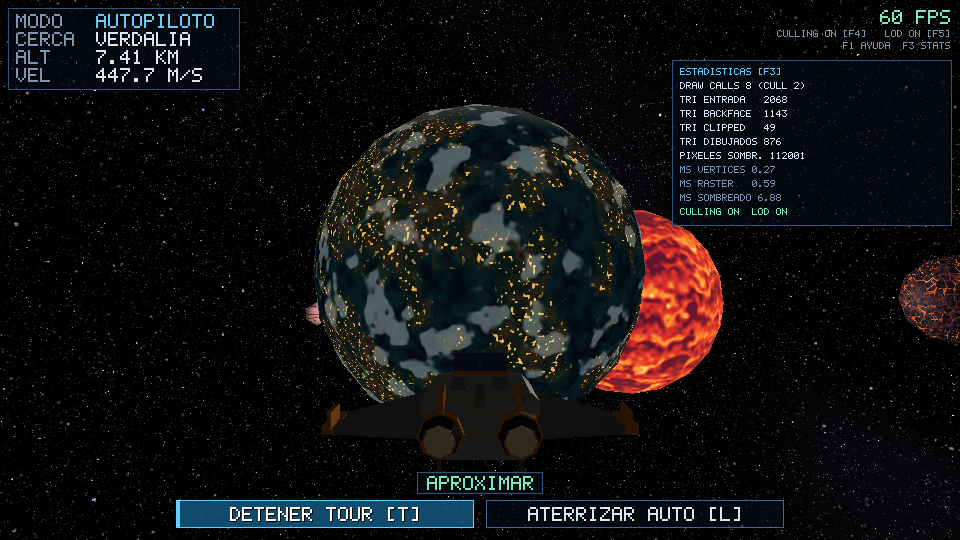
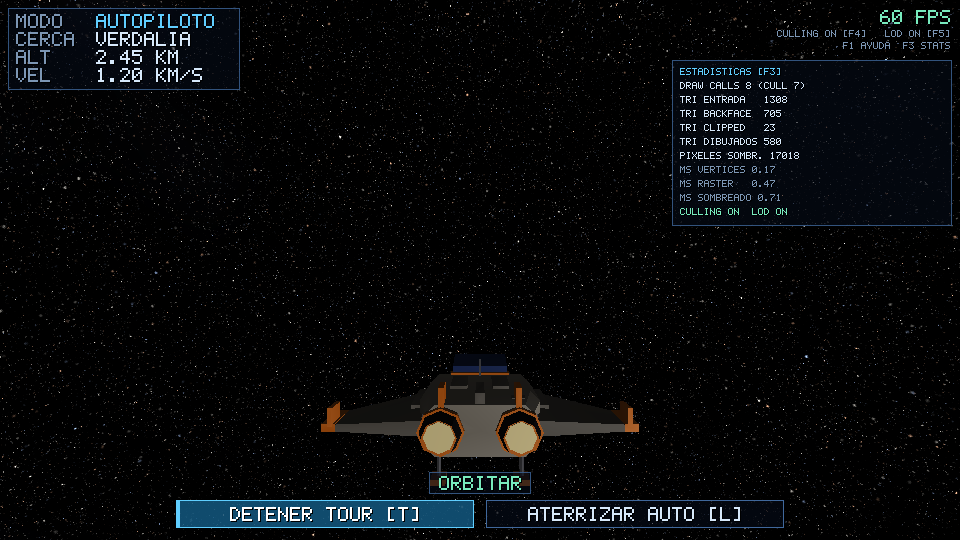

# Galaxy: sistema solar explorable con renderizador por software

Proyecto final de Gráficas por Computadora 2026 (entrega 20/11/2026). Es un sistema solar pequeño en Rust: un sol, cinco planetas con órbita y rotación, una nave propia que se controla con inercia, gravedad y colisión, y un Tour automático que viaja de planeta en planeta, orbita, desciende y aterriza. Todo el dibujo se calcula en la CPU con un pipeline propio (matrices, recorte, z-buffer, rasterizado por tiles y sombreado diferido). Raylib solo abre la ventana, lee el teclado y el ratón y muestra el framebuffer como una textura 2D.

[CAPTURA: portada, nave frente a un planeta con el HUD y el panel de estadísticas abierto]



## Compilar y ejecutar

Necesitas Rust (edición 2024, cargo reciente), CMake y un compilador de C, porque `raylib` construye su biblioteca nativa la primera vez. Las únicas dependencias son `raylib` y `rayon` (ver `Cargo.toml`); Cargo las descarga solo.

```bash
cargo test                       # 74 pruebas (3 ignoradas: benchmarks y una con ventana)
cargo run --release              # ventana interactiva 960x540
cargo run --release -- --tour    # igual, pero con el Tour automático ya iniciado
```

Siempre ejecuta desde la raíz del repositorio: el programa carga `assets/models/ship.obj` con una ruta relativa. Usa `--release`; en modo debug el sombreado por CPU es demasiado lento.

Opciones de línea de comandos (las que imprime `--help`):

| Opción | Qué hace |
|---|---|
| `--tour` | Abre la ventana con el piloto automático iniciado |
| `--bench [--frames N]` | Recorre el Tour sin ventana con y sin culling/LOD y compara tiempos y triángulos (N=3000 por defecto) |
| `--record DIR [--frames N] [--every K]` | Guarda en `DIR` un PNG cada K cuadros del Tour (N=1800 y K=60 por defecto), sin ventana |
| `--shot out.png [--time T] [--stats]` | Vista del sistema en un PNG (`--stats` imprime los contadores) |
| `--shot-ship out.png [--time T]` | Vista de la nave en un PNG |

Para generar el video de la demostración se necesita `ffmpeg`:

```bash
scripts/record-demo.sh           # graba 90 s del Tour y arma videos/galaxy-demo.mp4
scripts/video.sh frames video.mp4   # solo convierte un directorio de cuadros (60 fps, 960x540, H.264 yuv420p)
```

`record-demo.sh` acepta `CUADROS` y `CADA_K` como argumentos (`scripts/record-demo.sh 3600 1`). Cada PNG pesa unos 2 MB, así que 90 s con `CADA_K=2` ocupan unos 5 GB en `frames/` (carpeta ignorada por git). Si la secuencia se grabó con `--every K`, `video.sh` necesita `FPS_ENTRADA=$((60/K))`; `record-demo.sh` ya lo hace.

## Controles

Tomados de `src/platform.rs` y de la pantalla de ayuda (`F1`, `HELP_ROWS` en `src/hud.rs`).

| Tecla | Acción |
|---|---|
| `W` / `S` | Adelante / atrás |
| `A` / `D` | Lateral izquierda / derecha |
| `Q` / `E` | Abajo / arriba |
| Flechas | Cabeceo y guiñada |
| `Z` / `C` | Alabeo |
| `Shift` / `Ctrl` | Boost / freno |
| `G` | Gravedad encendida / apagada |
| `X` | Asistencia de vuelo encendida / apagada |
| `T` o clic en el botón del HUD | Iniciar / detener el Tour automático |
| `L` o botón `ATERRIZAR AUTO` | Aterrizaje automático (solo si la nave está en ORBITA o DESCENSO sobre un planeta aterrizable) |
| `F1` | Ayuda con la tabla de controles |
| `F3` | Panel de estadísticas del pipeline |
| `F4` | Frustum culling encendido / apagado |
| `F5` | LOD encendido / apagado |
| `P` | Captura PNG en `screenshots/vista-N.png` |
| `Esc` | Salir |

Cualquier mando del jugador interrumpe el Tour y devuelve el control sin saltos.

Las teclas `1`-`6` inician un viaje automático al cuerpo elegido (`1` es el sol; llega, orbita una vuelta y devuelve el control). El botón derecho del ratón con arrastre es mirada libre de la cámara (vuelve suave al soltar). `M` o el botón central alterna que el ratón timonee la nave. La nave también se orienta con flechas y `Z`/`C`.

## Arquitectura del pipeline

```
mundo (f64)  ->  vértices  ->  ensamblado y recorte  ->  tiles  ->  sombreado diferido  ->  framebuffer  ->  raylib (textura)
src/world        raster/pipeline.rs (todo el rasterizador)                                     src/platform.rs
```

| Etapa | Qué hace | Dónde |
|---|---|---|
| Mundo y tiempo | Posición orbital y rotación como función analítica del tiempo de simulación; origen flotante (resta en `f64`, luego pasa a `f32`) | `src/world/mod.rs` (`Body::position`, `body_model_matrix`) |
| Geometría | Icosfera subdividida (20·4ⁿ triángulos), niveles de detalle, lector OBJ | `src/geometry/sphere.rs`, `lod.rs`, `obj.rs` |
| Culling por llamada | Prueba esfera contra los 6 planos del frustum antes de procesar vértices | `raster/pipeline.rs` (`frustum_planes`, `sphere_visible`) |
| Vértices | Transforma con `vista * modelo` y luego la proyección | `raster/pipeline.rs`, matrices en `src/math.rs` (`Mat4::perspective`, `look_at`, `translation`, `rotation_y`, `scale`) |
| Ensamblado y recorte | Descarte de caras traseras, recorte contra el plano cercano (`clip_near`), conversión a punto fijo 28.4 | `raster/pipeline.rs` (`setup`, `clip_near`) |
| Tiles | La pantalla se divide en tiles de 64x64 que se rasterizan en paralelo con `rayon`; cada tile guarda un buffer de visibilidad con z-buffer `1/w` | `raster/pipeline.rs` (`TILE`, `raster_tile`) |
| Sombreado diferido | Solo se ejecuta el shader en los píxeles que ganaron la prueba de profundidad | `raster/pipeline.rs`, trait `FragmentShader` en `src/raster/mod.rs` |
| Shaders | Un shader propio por cuerpo, más anillo, nave y cielo | `src/shading/` |
| Cielo | Cubemap de estrellas precalculado al arrancar | `src/app.rs` (`SkyBox`) |
| Simulación | Paso fijo de 1/120 s con acumulador, física, gravedad, colisión, modos de vuelo, autopiloto | `src/ship/` |
| HUD | Fuente bitmap y botones dibujados en el framebuffer | `src/hud.rs` |
| Ventana | Único módulo que usa raylib | `src/platform.rs` |

[CAPTURA: diagrama o foto del panel F3 con todos los contadores]

## Cumplimiento de los requisitos eliminatorios

| Requisito | Dónde se ve o se verifica |
|---|---|
| Pipeline de software propio; raylib solo ventana, entrada y mostrar el framebuffer | Solo `src/platform.rs` usa raylib (ventana, teclado, ratón, `update_texture` y `draw_texture_pro`). `src/hud.rs` escribe en el framebuffer a mano. No se usa `draw_model`, `Camera3D`, shaders GLSL ni física de raylib |
| Sol, nave modelada por nosotros y al menos un planeta | Sol Ígnea y cinco planetas en `world::solar_system`. La nave `assets/models/ship.obj` se genera con `assets/src/make_ship.py`; ver `screenshots/nave.png` (`cargo run --release -- --shot-ship nave.png`) |
| Nave controlable | `src/ship/physics.rs` (`step`); probar con `W/A/S/D/Q/E`, flechas, `Shift` y `Ctrl` |
| Planetas que orbitan y rotan según el tiempo transcurrido, no los cuadros | `Body::position(t)` y `Body::rotation_angle(t)` en `src/world/mod.rs` son funciones puras del tiempo; la prueba `orbit_is_periodic_and_stateless` lo verifica. El tiempo `sim.t` avanza en múltiplos exactos de 1/120 s (`src/ship/stepper.rs`); la prueba `fixed_step_is_frame_rate_independent` simula con distintos FPS y obtiene la misma posición |
| Acercarse y alejarse sin pantalla de carga | Un solo mundo y un solo bucle (`app::run`); el LOD cambia de malla en caliente con histéresis. Se ve en el Tour o volando hacia Verdalia |
| Poder orientar la nave y ver el entorno al acercarse | La nave se orienta con flechas y `Z`/`C`; con el botón derecho del ratón se mira libremente sin cambiar el rumbo (`src/ship/camera.rs`, `CameraRig::update`) |
| Matrices de modelo, vista y proyección y prueba de profundidad | `body_model_matrix` (modelo), `CameraRig::view_matrix` (vista), `Mat4::perspective` (proyección) y el z-buffer `1/w` de `raster/pipeline.rs`; pruebas en `src/raster/tests.rs` |
| Al menos un shader de fragmentos propio | Seis shaders en `src/shading/` (sol, Verdalia, Siroco, Mutante, Nix, Fornax) más anillo, nave y cielo |
| Entrega: código, recursos, instrucciones y video del recorrido | Este README, `assets/`, `scripts/record-demo.sh` y `scripts/video.sh`. `[VIDEO: enlace al mp4 final]` |

El video debe mostrar vuelo espacial, acercamiento, vuelta alrededor de un planeta y alejamiento: el Tour hace exactamente esa secuencia (ver `docs/10-guion-demo.md`).

## Características del menú que se solicitan evaluar y dónde verlas

Los contadores de `F3` son: `DRAW CALLS (CULL n)`, `TRI ENTRADA`, `TRI BACKFACE`, `TRI CLIPPED`, `TRI DIBUJADOS`, `PIXELES SOMBR.` y los milisegundos de vértices, raster y sombreado.

| Característica | Estado | Dónde está | Cómo demostrarlo en vivo |
|---|---|---|---|
| Planetas (5) | Hecho | `world::solar_system` en `src/world/mod.rs`: Fornax, Verdalia, Mutante, Siroco y Nix, más el sol Ígnea | `--shot screenshots/sistema.png` los muestra en fila; en la ventana, volar hacia cada uno o dejar el Tour |
| Shaders propios (4 distintos) | Hecho | `src/shading/`: `rocky.rs` (Verdalia), `giant.rs` (Siroco), `ice.rs` (Nix), `volcanic.rs` (Fornax), más `sun.rs`, `pixel.rs`, `props.rs` y `sky.rs`. `shader_for` en `src/shading/mod.rs` | Acercarse a cada planeta y comparar su aspecto |
| Shader animado | Hecho | Lava de Fornax y nubes de Verdalia (usan `Uniforms::time`), tormenta de Siroco, granulación del sol, vaca a cerdo de Mutante (24 s de ciclo, `pixel.rs`) | Mirar Siroco o el sol unos segundos: las bandas y la granulación cambian solas |
| Deformación por ruido | Hecho | `relief::height` (`src/relief.rs`) desplaza cada planeta (Verdalia ±3 %, Fornax ±3.5 %, Nix ±2 %, Mutante ±2.5 % en 16 escalones) mediante `geometry::displace`; `relief::displaced_lods` genera la malla de cada nivel de LOD | Mirar la silueta de Verdalia o Fornax de cerca: ya no es una esfera lisa |
| Subdivisión procedural de geometría | Hecho | `icosphere(n)` en `src/geometry/sphere.rs` genera 20·4ⁿ triángulos; `SphereLods` crea los niveles 0 a 5 al arrancar | Con `F5` apagado todos los planetas usan el nivel 5; con `F5` encendido se ve `TRI ENTRADA` bajar |
| Descarte fuera de vista (culling) | Hecho | Frustum culling por esfera y descarte de caras traseras en `raster/pipeline.rs`; contadores en `Stats` (`src/raster/mod.rs`) | `F3`; mirar a otro lado y ver subir `CULL` en `DRAW CALLS`; `F4` apaga el frustum culling y `TRI ENTRADA` sube |
| Niveles de detalle (LOD) | Hecho | LOD de geometría por error de silueta en píxeles: `SphereLods::select_with_hysteresis` en `src/geometry/lod.rs`. LOD del shader: el uniforme `detail` y `octaves` en `src/shading/noise.rs`, calculado en `Scene::render` (`src/app.rs`) | `F3` y alejarse o acercarse a un planeta viendo `TRI ENTRADA`; `F5` apaga todo el LOD |
| Aceleración progresiva con paso fijo | Hecho | `src/ship/stepper.rs` (`FixedStepper`, 1/120 s con acumulador) y `src/ship/physics.rs`: la entrada fija una aceleración objetivo que la nave alcanza con constante de tiempo `TAU_ACCEL` (`src/ship/modes.rs`) | Mantener `W` y ver el `VEL` del HUD subir gradualmente; soltar y ver que se frena con suavidad. La prueba `fixed_step_is_frame_rate_independent` lo asegura |
| Gravedad | Hecho | `Body::gravity_at` en `src/world/mod.rs` y `effective_gravity` en `src/ship/physics.rs` | Apagar la asistencia con `X`, acercarse a un planeta con `G` activo y soltar los motores: la trayectoria se curva. Con `G` apagada sigue recta |
| Colisión | Hecho (contra el relieve) | `collide` en `src/ship/physics.rs`: nave como esfera de 6 m contra `surface_height_at` (radio * (1 + `relief::height`)) | Dirigirse al suelo sin frenar: rebota; a baja velocidad se posa (modo POSADA) |
| Control local alrededor de un planeta | Hecho | Modos ORBITA y DESCENSO en `update_mode` (`src/ship/physics.rs`) y constantes en `src/ship/modes.rs`; la nave hereda el movimiento del planeta | El HUD (`MODO`) cambia a ORBITA al bajar de 3 radios; el planeta deja de "escaparse" y se puede rodear a baja velocidad |
| Presentación | Hecho | HUD con modo, planeta cercano, altitud y velocidad, botones del Tour, ayuda (`F1`) y estadísticas (`F3`) en `src/hud.rs` | `F1` y `F3` |

También funcionan, aunque no están en la lista de puntos: Tour automático y aterrizaje automático (`src/ship/autopilot.rs`), anillo de Siroco como malla propia (`geometry::ring_mesh`) y cielo con cubemap.

En desarrollo y todavía no implementado: terreno con chunks y LOD continuo a nivel de suelo, objetos de superficie (los modelos `tree.obj`, `obsidian.obj` e `ice_crystal.obj` ya existen en `assets/models/` pero la escena no los carga), distribución con semilla, mapa de normales, luna de Verdalia, y los planetas Dunara, Nublar y Egrin de `docs/07-assets-y-temas.md`. El tren de aterrizaje ya se anima (`src/shipmodel.rs`). El plan está en `docs/`.

## Parámetros para cambiar en la demostración

Se cambian en el código y se recompila con `cargo run --release` (no hay archivo de configuración).

| Qué | Dónde | Cómo |
|---|---|---|
| Radio de un planeta | `world::solar_system` en `src/world/mod.rs`. Cada fila es `b(tipo, nombre, radio, orbit_radius, orbit_period, rotation_period, inclinación, fase, gm, aterrizable)`; el radio es el tercer valor (por ejemplo `3500.0` en Verdalia) | La gravedad superficial se recalcula sola porque `gm = g(radio)` con `g = 30·r²` |
| Velocidad orbital | Misma fila: `orbit_period` (segundos por vuelta; menor valor, órbita más rápida, por ejemplo `800.0` en Verdalia) y `orbit_radius` (metros al sol) | La órbita es función del tiempo, así que el cambio se nota de inmediato |
| Velocidad de rotación | `rotation_period`, el valor siguiente (segundos por vuelta) | Se ve en el patrón del planeta, que gira con el cuerpo |
| Fuerza de la gravedad | `let g = |r: f64| 30.0 * r * r;` en `solar_system`; alcance en `Body::influence_radius` (8 radios) y suavizado en `gravity_epsilon` | Apagar con `G` para comparar |
| Umbral de LOD de la geometría | `MAX_ERROR_PX` (2 px) en `src/geometry/lod.rs`; histéresis `LOD_MARGIN` y niveles máximos (`SphereLods::new(5, ...)`) en `src/app.rs` | Subir `MAX_ERROR_PX` usa mallas más gruesas; verlo con `F3` |
| LOD de los shaders | `detail = (coverage * 8.0).clamp(0.15, 1.0)` en `Scene::render` (`src/app.rs`) y `octaves` en `src/shading/noise.rs` | `F5` lo fuerza a 1.0 |
| Intensidad del bump y parallax de Fornax | Banderas `bump` y `parallax` de `VolcanicShader` (`shader_for` en `src/shading/mod.rs`); fuerza en `src/shading/volcanic.rs`: factores `0.014` (placas), `0.10` (basalto) y `0.03` (parallax) | Poner `bump: false` o `parallax: false` y comparar con Fornax de cerca |
| Cantidad de continentes y nubes en Verdalia | Umbrales `smooth(0.44, 0.54, ...)` (tierra) y `smooth(0.54, 0.63, ...)` (nubes) en `src/shading/rocky.rs` | Cambia de inmediato la apariencia de Verdalia |
| Velocidad de la tormenta y el sol | `t * 0.45` en `src/shading/giant.rs`; `t * 0.32` en `src/shading/sun.rs` | |
| Respuesta de la nave | `ACCEL_FWD`, `TAU_ACCEL`, `RATE_*`, `CRUISE_SPEED`, `BOOST_SPEED` en `src/ship/modes.rs` | |
| Resolución | `WIDTH` y `HEIGHT` en `src/app.rs` | |
| Frecuencia de simulación | `FixedStepper::default_120` en `src/ship/stepper.rs` | |

## Medición de rendimiento

`cargo run --release -- --bench --frames 600` recorre el mismo Tour sin ventana, primero con culling y LOD y después sin ellos. Medido en la máquina de desarrollo (16 hilos lógicos, 960x540, modo release), con otros procesos usando la CPU al mismo tiempo, así que los milisegundos varían entre ejecuciones de 10 a 15 ms:

| Configuración | ms medio | ms máx | triángulos entrada | triángulos dibujados | draw calls descartadas |
|---|---|---|---|---|---|
| culling + LOD | 10.33 | 45.67 | 2 000 | 832 | 3 |
| sin culling, sin LOD | 10.79 | 27.36 | 124 572 | 17 771 | 0 |

Desglose por etapa (ms por cuadro): con culling y LOD, cielo 1.52, vértices 0.38, raster 0.64, sombreado 7.71. Sin ellos, cielo 1.22, vértices 1.84, raster 0.82, sombreado 6.86.

Lectura honesta: el LOD y el culling reducen los triángulos de entrada unas 60 veces y la etapa de vértices casi 5 veces, pero el tiempo total cambia poco porque el cuello de botella es el sombreado por píxel de los planetas grandes, que no depende del número de triángulos. Todavía no se midió en un equipo de 4 núcleos. Los contadores en vivo están en `F3`.

[CAPTURA: panel F3 con culling y LOD encendidos, y otra con `F4` y `F5` apagados]

## Capturas

| | |
|---|---|
|  |  |
| `--shot screenshots/sistema.png --time 5` | `--shot-ship screenshots/nave.png --time 3` |
|  |  |
| Cuadro del Tour (`--record`) acercándose a Verdalia | Cuadro del Tour orbitando |

[CAPTURA: aterrizaje en un planeta, nave posada]
[CAPTURA: Fornax de cerca, lava animada]
[CAPTURA: Siroco con su anillo]

## Recursos externos y asistencia de IA

- **Asistencia de IA.** Este proyecto se desarrolló con Claude Code (Anthropic), usando varios agentes que generaron código y documentación bajo mi dirección: yo definí el alcance, la arquitectura y las decisiones, y los agentes escribieron buena parte de las implementaciones, pruebas y scripts. Revisé el resultado y puedo explicarlo, pero declaro que una gran parte del código fue generada con IA.
- **Dependencias.** Solo `raylib` 5.5 (ventana, entrada y textura 2D) y `rayon` 1 (paralelismo por tiles).
- **Shaders.** Adaptados del laboratorio de la materia `lab6` (Atlas de mundos): Ígnea, Verdalia, Siroco, Mutante, Nix y Fornax, portados a este pipeline.
- **Pipeline.** El lector de OBJ y la idea del rasterizado baricéntrico con z-buffer vienen del laboratorio `cargar-modelo`; aquí se reescribieron con tiles, punto fijo y sombreado diferido.
- **Modelos.** La nave y los tres props (árbol, obsidiana, cristal de hielo) los generé con scripts propios en `assets/src/` (`make_ship.py`, `make_props.py`, `meshlib.py`), sin Blender y sin modelos descargados. Detalles en `assets/models/ship.md`.
- No se usan texturas ni imágenes externas; todo el color sale de ruido procedural.

## Integrantes y contribuciones

El proyecto es individual.

| Integrante | Correo | Contribución |
|---|---|---|
| [NOMBRE] | marcoalejandro.diazcastaneda@gmail.com | Todo el proyecto: diseño, integración, revisión del código generado con IA, shaders, simulación, HUD, assets y entrega |

[PENDIENTE: ajustar la descripción de contribuciones antes de entregar]

## Documentación del proyecto

El plan completo está en `docs/` (empezar por `docs/00-indice.md`); el estado actual en `docs/09-estado.md` y el guion de la demostración en `docs/10-guion-demo.md`.
